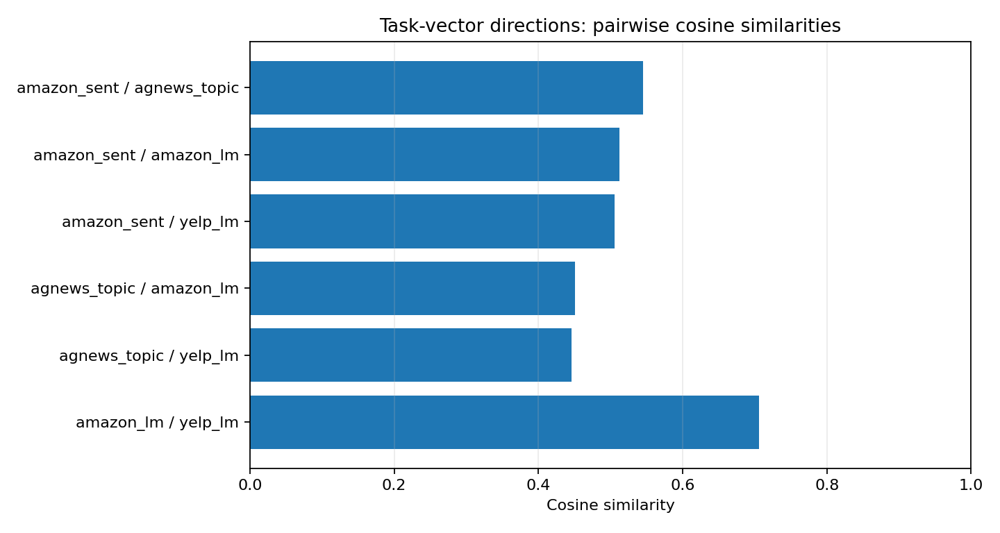
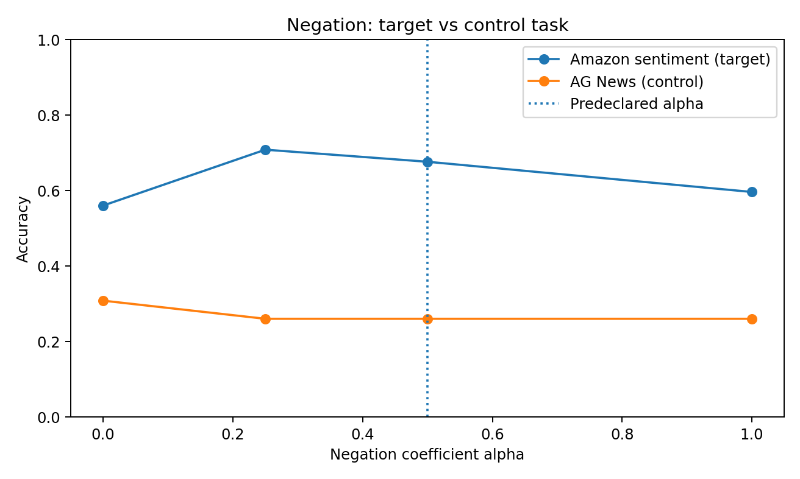
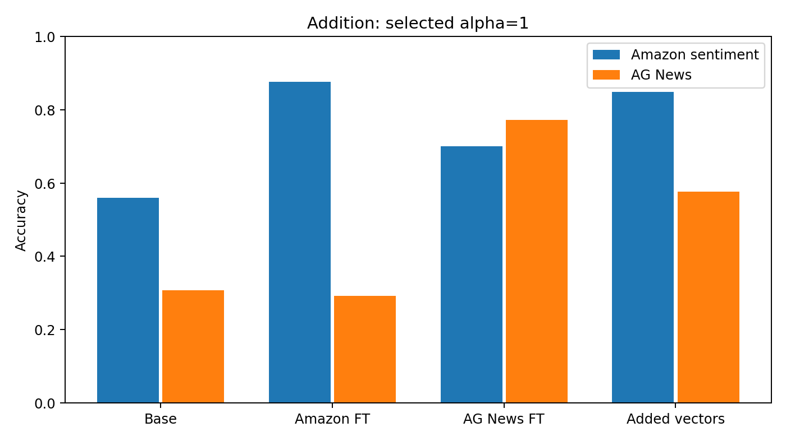
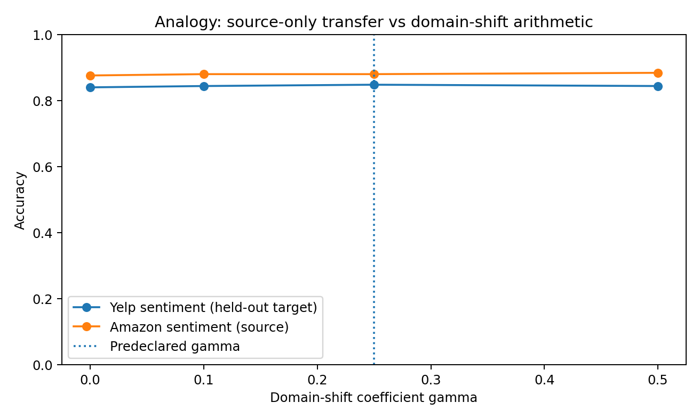

# Recorded results and analysis

**English** | [한국어](README.ko.md) · [Project overview](../README.md) · [Executed Colab notebook](../notebooks/run_in_colab.ipynb)

## Summary

This directory archives **one completed real-data Google Colab run** of weight-space task arithmetic on T5-small. The files [`run_summary.json`](run_summary.json), [`metrics.csv`](metrics.csv), and the three PNGs in [`figures/`](figures/) are the **original outputs downloaded from the experiment runtime**, not numbers recreated from a screenshot or from the notebook's printed log. Derived compact tables live in [`published/`](published/).

| Operation | Primary observation | Interpretation |
|---|---|---|
| **Negation** | Amazon **56.0% → 67.6%** at $\alpha=0.5$; AG News control **30.8% → 26.0%** | **Selective forgetting was not observed** |
| **Addition** | Merged model: Amazon **84.8%** and AG News **57.6%** | **Both exceed the base model; substantial specialist gap remains** |
| **Analogy** | Yelp sentiment **84.0% → 84.8%** relative to source-only transfer | **Net +0.8 percentage points; effect inconclusive** |

All test rows below use **250 examples per task**. One training seed (`42`) and one run were used. This is **not** a full reproduction of the original paper or a statistically established finding.

## 1. Experiment provenance and method

| Setting | Archived value |
|---|---|
| Run completion timestamp | `2026-10-24T18:03:36.189579+00:00` (UTC) |
| Run status | `completed`, real public datasets |
| Base checkpoint | `google-t5/t5-small` |
| Device | NVIDIA Tesla T4, Google Colab (recorded in executed notebook) |
| Independent fine-tunes | `amazon_sent`, `agnews_topic`, `amazon_lm`, `yelp_lm` |
| Supervised data | 1,600 training examples and 200 validation examples per task |
| Domain LM data | 2,500 unlabeled reviews and 300 validation reviews per domain |
| Optimization | 180 steps per checkpoint; learning rate `0.0001`; batch size 4; accumulation 2 |
| Evaluation | 80 source validation examples/task for coefficient selection; 250 held-out test examples/task |
| LM approximation | Consecutive 96-token chunks trained with a seq2seq proxy |
| Classification metric | Candidate-label length-normalized conditional log-likelihood with EOS |

Inputs were drawn from [Amazon Polarity](https://huggingface.co/datasets/fancyzhx/amazon_polarity), [AG News](https://huggingface.co/datasets/fancyzhx/ag_news), and [Yelp Polarity](https://huggingface.co/datasets/fancyzhx/yelp_polarity). Yelp labels were excluded from the domain language-modeling training data and were **not used to select hyperparameters**; held-out Yelp labels were used only for final evaluation. Dataset row counts and provenance are recorded in the original JSON.

## 2. Extracted task vectors

A task vector is the difference between independently fine-tuned and base parameters:

$$\tau_t = \theta_t - \theta_0.$$

| Task vector | $\lVert\tau_t\rVert_2$ | Max. absolute reconstruction error | Tensors |
|---|---:|---:|---:|
| Amazon sentiment | 10.852879 | $2.3283\times 10^{-10}$ | 131 |
| AG News | 12.699175 | $2.3283\times 10^{-10}$ | 131 |
| Amazon LM | 13.390650 | $4.6566\times 10^{-10}$ | 131 |
| Yelp LM | 13.436141 | $4.6566\times 10^{-10}$ | 131 |

The numerical reconstruction check $\theta_0+\tau_t\approx\theta_t$ succeeded. This validates weight arithmetic implementation consistency, not the existence of semantically isolated task capabilities.

**Pairwise cosine similarities** (from the original JSON):

| Pair | Cosine similarity |
|---|---:|
| Amazon sentiment ↔ AG News | 0.544976 |
| Amazon sentiment ↔ Amazon LM | 0.512805 |
| Amazon sentiment ↔ Yelp LM | 0.505949 |
| AG News ↔ Amazon LM | 0.450671 |
| AG News ↔ Yelp LM | 0.445465 |
| Amazon LM ↔ Yelp LM | **0.705692** |



The two LM updates have the highest cosine similarity among the observed pairs. They share an objective, but their measured similarity alone does not establish why the addition model exhibits interference.

## 3. Negation

$$\theta_{\mathrm{neg}}=\theta_0-\alpha\tau_{\mathrm{AmazonSent}}.$$

| Coefficient $\alpha$ | Amazon sentiment | AG News control | Amazon correct / 250 | AG News correct / 250 |
|---:|---:|---:|---:|---:|
| 0 (base) | 56.0% | 30.8% | 140 | 77 |
| 0.25 | 70.8% | 26.0% | 177 | 65 |
| **0.5 (predeclared)** | **67.6%** | **26.0%** | **169** | **65** |
| 1.0 | 59.6% | 26.0% | 149 | 65 |

The separately fine-tuned Amazon classifier achieved **87.6%** on Amazon and **29.2%** on AG News; it is a reference checkpoint, not one of the negative edits.



**Interpretation:** All tested negative coefficients **increased** Amazon accuracy relative to the original 56.0%, instead of selectively decreasing it. For the predeclared $\alpha=0.5$, the target rose by **11.6 percentage points** and the control declined by **4.8 points**. Thus selective forgetting was **not reproduced** under this setup. Note that the original four-class AG News control begins at **30.8%**, limiting the strength of the selectivity test.

The raw JSON also records `mean_gold_token_nll` and `mean_gold_label_probability`. In this case, target accuracy can rise even while gold-token NLL increases (e.g., **10.2893 → 19.5659** for $\alpha=0.5$). These are different measurements: accuracy depends on the ranking among a fixed set of labels, while token NLL measures absolute gold-label likelihood. They should not be treated as interchangeable.

## 4. Addition

$$\theta_{\mathrm{add}}=\theta_0+\alpha(\tau_{\mathrm{AmazonSent}}+\tau_{\mathrm{AGNews}}).$$

A single shared coefficient was selected using **Amazon and AG News validation labels**. Five candidates were evaluated: 0, 0.25, 0.5, 0.75, and 1.0. The score averaged each task's accuracy normalized to its own validation specialist accuracy; **$\alpha=1.0$** was selected (`validation_selection_score = 0.8705153`). The test data did not determine this coefficient.

| Model on held-out test | Amazon sentiment | AG News |
|---|---:|---:|
| Base | 56.0% (140/250) | 30.8% (77/250) |
| Amazon fine-tuned | 87.6% (219/250) | 29.2% (73/250) |
| AG News fine-tuned | 70.0% (175/250) | 77.2% (193/250) |
| **Addition ($\alpha=1.0$)** | **84.8% (212/250)** | **57.6% (144/250)** |



**Interpretation:** Addition increased Amazon accuracy by **28.8 pp** and AG News by **26.8 pp** relative to the base model, in the *same* edited checkpoint. Compared with the respective task specialists, the merged model was lower by **2.8 pp** (Amazon) and **19.6 pp** (AG News). The run therefore supports multi-task performance improvement **relative to the base**, not a claim of interference-free merging or specialist-equivalent accuracy.

## 5. Analogy

$$\theta_{\mathrm{analogy}}=\theta_0+\beta\tau_{\mathrm{AmazonSent}}+\gamma(\tau_{\mathrm{YelpLM}}-\tau_{\mathrm{AmazonLM}}).$$

The source sentiment coefficient $\beta=0.5$ was selected using **Amazon validation only**. Values 0.5, 0.75, and 1.0 all attained **73/80 = 91.25%** on the recorded Amazon validation set; the implementation's first-max tie rule selected 0.5. The primary domain coefficient **$\gamma=0.25$ was specified before evaluating Yelp**. Other gamma choices are exploratory sensitivity checks.

| Variant | Yelp held-out | Amazon test |
|---|---:|---:|
| Base | 59.2% (148/250) | 56.0% (140/250) |
| Source sentiment only ($\gamma=0$) | **84.0% (210/250)** | 87.6% (219/250) |
| $\gamma=0.1$ (exploratory) | 84.4% (211/250) | 88.0% (220/250) |
| **$\gamma=0.25$ (primary)** | **84.8% (212/250)** | **88.0% (220/250)** |
| $\gamma=0.5$ (exploratory) | 84.4% (211/250) | 88.4% (221/250) |
| Domain-shift vector only, no sentiment vector | **58.4% (146/250)** | — |



**Interpretation:** Most Yelp improvement (59.2% → 84.0%) came from applying the Amazon sentiment direction. The extra domain correction at the specified gamma improved the *total number correct* from 210 to 212, a **net gain of two correct predictions out of 250 (+0.8 pp)**. The domain-only control did not help on Yelp. The effect is **inconclusive** without additional seeds, larger tests, and full paired predictions. Net gain of two does *not* imply the same two individual examples alone switched from incorrect to correct.

## 6. Limits of the evidence

1. **Single run, single seed:** No repeated training seeds, uncertainty intervals, or significance test.
2. **Incomplete example-level comparisons:** Each evaluation row of the raw JSON saves only eight example prediction pairs (`prediction_sample`), not all 250 paired predictions. McNemar's test cannot be reconstructed from those examples.
3. **Small-data LM proxy:** Domain language modeling uses 96-token next-chunk seq2seq examples, not an identical reproduction of the paper's original objective.
4. **Weak control for Negation:** Base AG News performance is low; selectivity is difficult to establish with this control.
5. **Coefficient interpretation:** Negation and Analogy primary coefficients were designated in advance, but exploratory curves do not constitute independent experimental repetitions.
6. **Vector semantics:** Numerical checkpoint reconstruction does not establish that each task capability is wholly localized in one linear direction.

## 7. Versioned source artifacts

| File | Role |
|---|---|
| [`run_summary.json`](run_summary.json) | **Original full-precision Colab output**: 46 evaluations, counts, label-score statistics, coefficients, eight sample predictions per row, training configuration, vector metadata |
| [`metrics.csv`](metrics.csv) | **Original Colab CSV**, 46 rows, including `correct`, `examples`, and probability/NLL aggregates |
| [`figures/negation.png`](figures/negation.png) | **Original Colab plot**, not regenerated |
| [`figures/addition.png`](figures/addition.png) | **Original Colab plot**, not regenerated |
| [`figures/analogy.png`](figures/analogy.png) | **Original Colab plot**, not regenerated |
| [`provenance.json`](provenance.json) | SHA-256 digests of original files and their archived run identifier |
| [`published/metrics.csv`](published/metrics.csv) | Compact 46-row accuracy and count summary generated from original JSON |
| [`published/vectors.csv`](published/vectors.csv) | Norms, reconstruction errors, tensor counts from original JSON |
| [`published/cosine_similarities.csv`](published/cosine_similarities.csv) | Six full-precision cosine similarities from original JSON |
| [`published/recorded_run.json`](published/recorded_run.json) | Compact settings and run metadata sourced from original JSON |
| [`published/figures/vector_cosines.png`](published/figures/vector_cosines.png) | Supplementary figure based on the original cosine measurements |
| `published/figures/{negation,addition,analogy}.png` | Byte-identical mirrors of the three original charts, retained for compatibility with earlier repository layouts |
| [`../notebooks/run_in_colab.ipynb`](../notebooks/run_in_colab.ipynb) | Executable source code and preserved outputs from the recorded experiment |

To regenerate the compact tables and original-figure mirrors **without retraining**:

```bash
python scripts/export_recorded_results.py
```

The original JSON/CSV and three figures remain unchanged by this command. A new full training run through `bash scripts/run_all.sh` produces files with the same `results/` paths and can overwrite the archived results in the working tree; new runs should be documented and archived independently before committing.

## Reference

Ilharco, G., et al. (2023). [*Editing Models with Task Arithmetic*](https://arxiv.org/abs/2212.04089). ICLR 2023. Independent small-scale implementation with a simplified domain LM objective.
